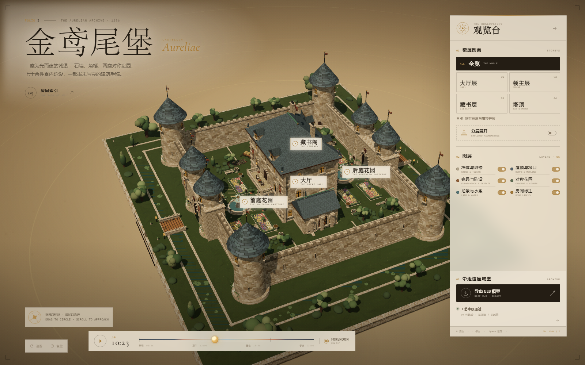
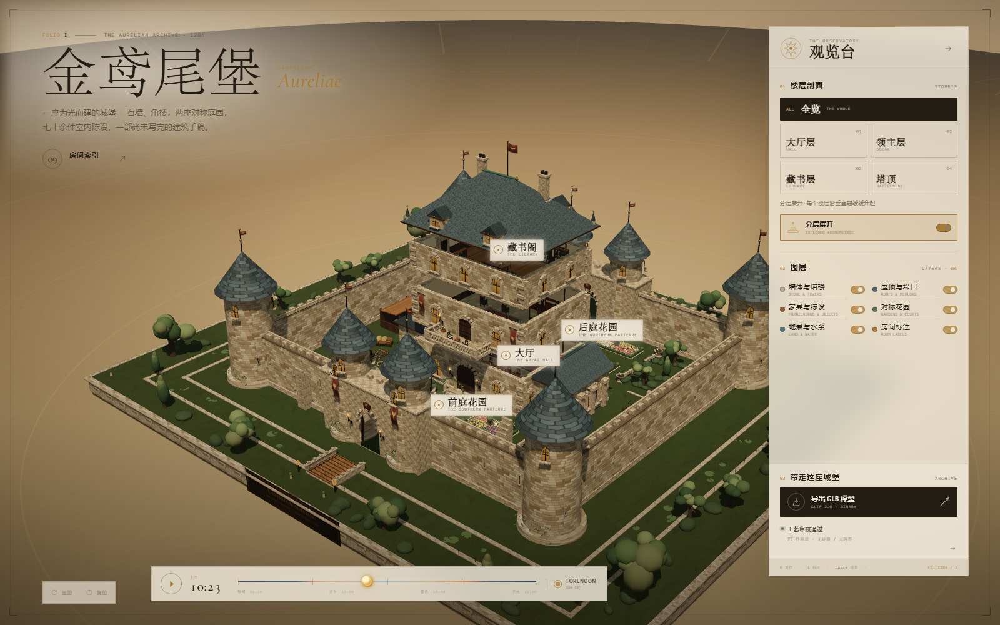
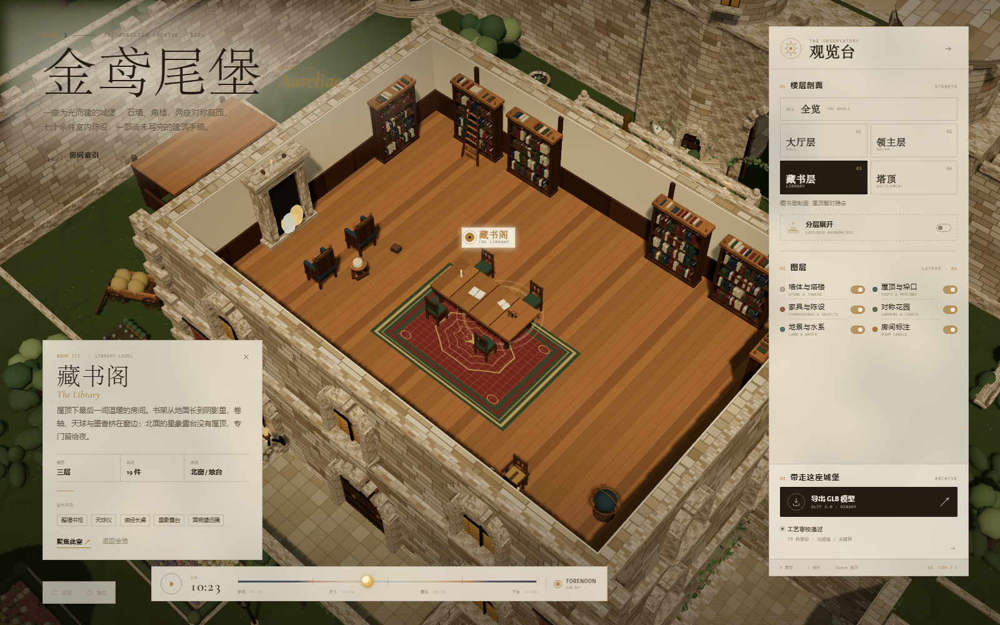
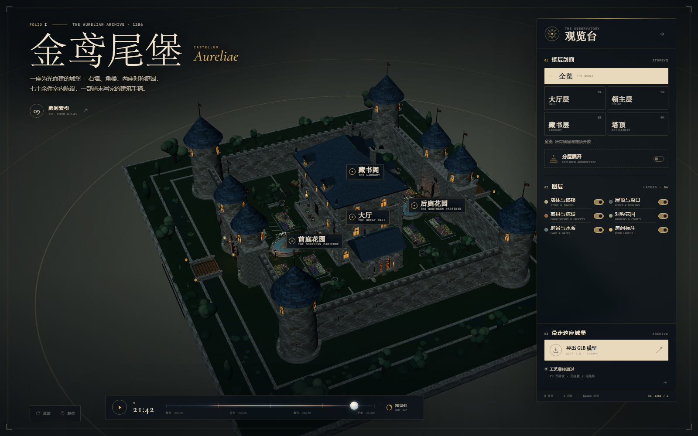
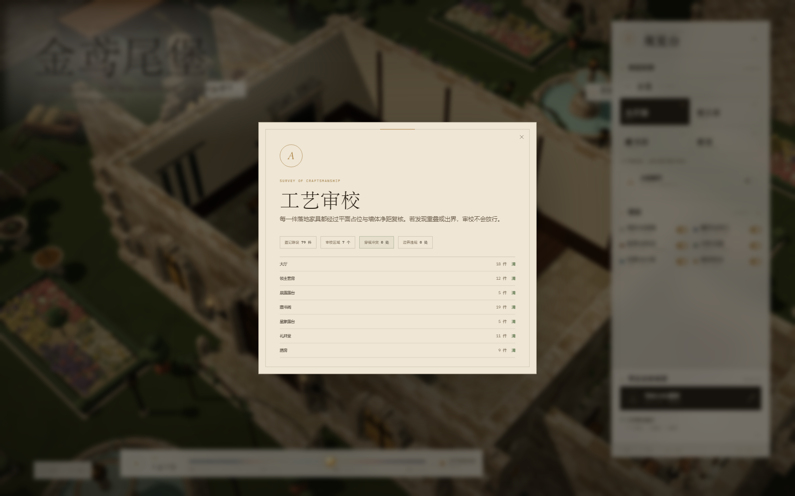
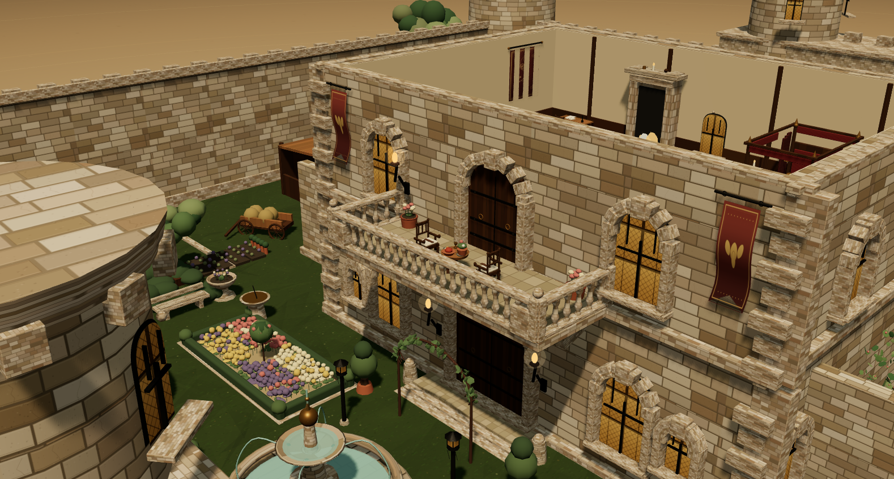
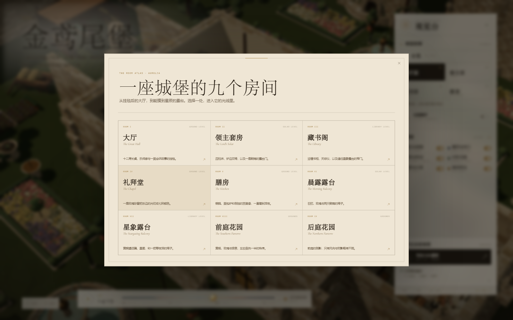
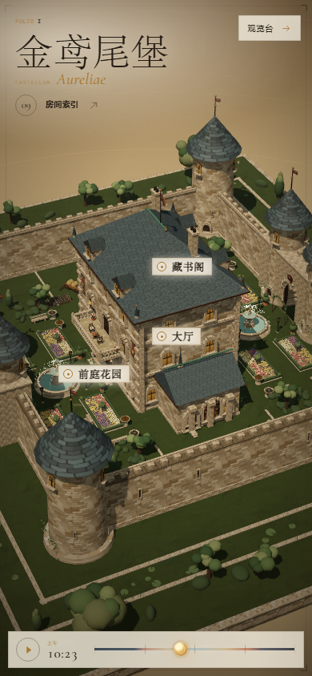
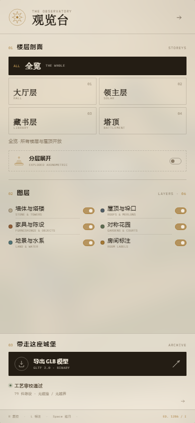

<div align="center">

# Castellum Aureliae

**A medieval castle built for light** — an interactive architectural maquette that runs entirely in the browser


[中文](README.md) · [English](README.en.md)

</div>



---

## What it is

A procedurally generated medieval castle. There are no external models and no image assets: stone, slate, timber, stained glass, fabric, grass and water are all painted at runtime on canvases, while the architecture, furniture, plants and lighting are assembled in the browser with Three.js.

It is also a model you can actually handle:

- **Orbit** — drag to circle the castle, scroll to move closer; there is no fixed guided path.
- **Floor sections** — five viewpoints (whole / hall / solar / library / battlements); roofs and walls peel away.
- **Exploded axonometric** — the three storeys rise along the vertical axis like an unfolded manuscript.
- **Room atlas** — nine rooms, each with its own dossier: level, orientation, furnishing count and design notes.
- **A day in light** — drag the timeline and the sun travels from dawn to midnight; window light, hearth glow, stars and the UI parchment all follow.
- **Take it away** — export the whole thing as a GLB 2.0 binary.



## Quick start

Requires **Node.js 18+** (20 LTS recommended) and **pnpm**.

```bash
git clone https://github.com/Jay-Victor/Medieval-Castle.git
cd Medieval-Castle
pnpm install
pnpm start
```

Then open <http://127.0.0.1:4173>.

On Windows you can also double-click **`start.bat`**: it checks Node.js and the dependencies, starts the server and opens the browser once it is ready.

> Serve over HTTP, do not open `index.html` from disk — the project uses native ES Modules and an import map, which `file://` cannot load.

## Controls

| Action | How |
| --- | --- |
| Orbit / zoom | drag the scene, scroll wheel |
| Open a room | click a room label, or “Room index” for the nine-room atlas |
| Floor section | right panel: whole / hall / solar / library / battlements |
| Exploded view | toggle “Exploded axonometric” |
| Day & night | drag the bottom timeline; `Space` starts the auto cycle |
| Layers | six switches for structure, roofs, furnishings, gardens, terrain, labels |
| Reset / labels | `R` resets the view, `L` toggles labels |
| Export | “Export GLB model” downloads the binary |

## The building

- **Architecture** — a three-storey keep, four corner towers, six gate towers, a twin gatehouse, curtain walls, merlons, a south morning balcony and a north star-gazing balcony, twin bridges, a moat, side wings and a stable workshop.
- **Nine rooms** — great hall, lord's solar, morning balcony, library, star-gazing balcony, chapel, kitchen, southern parterre, northern parterre.
- **Seven audited interiors** — 18 + 12 + 5 + 19 + 5 + 11 + 9 = **79 registered furnishings**.
- **Mirrored gardens** — two formal gardens cloned from a single template with opposite orientation: central fountains, four parterres, rose arcades, lamp posts, benches, clipped hedges, olive and cypress trees.



## A day in light

Sun and moon positions, sky gradients, window light, hearth glow, stars, fog and the parchment UI all change across 24 hours. At night the interior point lights, fireplace warmth and fireflies come up; dawn and dusk each have their own colour-temperature curve.

| Day 10:23 | Night 21:42 |
| --- | --- |
|  |  |

## Automated audit

`src/audit.js` validates every registered furnishing with world-space AABBs: table-top objects are checked for both plan footprint and vertical overlap, and every piece is checked against its room bounds.

```
PASS — 79 pieces in 7 rooms
hall 18 · solar 12 · balcony 5 · library 19 · star balcony 5 · chapel 11 · kitchen 9
collisions 0 · out of bounds 0
```

Click “Craftsmanship verified” in the app to read the per-room report.



## GLB export

`exports/Castellum-Aureliae.glb` is included:

- GLB 2.0 Binary, **15.86 MiB**
- 501 mesh nodes, 566,934 triangles, 87 materials
- terrain, architecture, interiors, gardens and instanced vegetation
- no pedestal, sky, UI, lights or cameras; exploded offsets are reset on export
- dense foliage uses `EXT_mesh_gpu_instancing` — open it with Three.js, Blender 4+ or any viewer supporting the extension

The “Export GLB model” button regenerates the file from the live scene.

## Demo film

The project ships with a 2:04 demo film (1920×1080, 30 fps): ten chapters, a Mandarin voice-over, on-screen annotations and a scripted cursor walkthrough.

- **Voice** — Kokoro-82M Chinese neural voice (`zf_xiaoxiao`, 24 kHz), synthesised clause by clause with punctuation-aware pauses
- **Picture** — the project's own renders on a stage, with programmatic camera moves, cursor choreography, callouts and a film grade
- **Score** — a D-minor drone and harp figures, synthesised, ducked under the narration

The film is ~190 MB, above GitHub's per-file limit, so it does not live in Git history — it ships as a **[release](../../releases)** asset.

**[▶ Download the film](https://github.com/Jay-Victor/Medieval-Castle/releases/latest/download/Castellum-Aureliae-demo-film-1080p.mp4)** (190 MB) ·
[subtitles](https://github.com/Jay-Victor/Medieval-Castle/releases/latest/download/Castellum-Aureliae-demo-film.srt)

The full pipeline — storyboard, timeline, how the picture and sound are made, rebuild commands — lives in
**[video/README.en.md](video/README.en.md)**. The narration text is in
[video/narration.en.md](video/narration.en.md) (中文: [narration.md](video/narration.md)), and the
sentence-level subtitles are in [video/subtitles.srt](video/subtitles.srt).

## Under the hood

- **Three.js 0.186**, native ES modules and an import map; no bundler, no framework
- **Procedural materials** — stone, slate, timber, stained glass, fabric, grass and water are generated as canvas textures
- **`FurnitureBuilder`** merges geometry per material; static architecture and interiors are welded into a handful of material batches
- **Performance** — about 503 runtime objects, 626 draw calls, 580k triangles; static shadow maps refresh on demand
- **Export** — `GLTFExporter`, after re-indexing geometry, resetting storey offsets and removing points/sprites
- **Responsive** — a full-screen mobile observatory tuned for 390 × 844

| | |
| --- | --- |
|  |  |
| morning balcony detail | the nine-room atlas |
|  |  |
| mobile | mobile observatory |

## Project layout

```
index.html              markup and UI
server.mjs              dependency-free static server (port 4173)
start.bat               one-click Windows launcher
src/main.js             scene, interaction, labels, day cycle, export
src/architecture.js     castle architecture
src/furniture.js        furniture library
src/furniture-scenes.js seven interior layouts
src/gardens.js          the two mirrored gardens
src/environment.js      terrain, moat, bridges, pedestal
src/lighting.js         sky, sun/moon, day-night palette
src/materials.js        material library
src/textures.js         procedural textures
src/audit.js            collision / bounds audit
src/bake.js             static geometry welding
previews/               rendered stills
exports/                exported GLB
video/                  demo film pipeline (see video/README.md)
```

## Requirements

| | |
| --- | --- |
| Node.js | 18+ (20 LTS recommended) |
| Package manager | pnpm or npm |
| Browser | any modern browser with WebGL2 and import map support (Chrome / Edge / Firefox / Safari 16.4+) |
| GPU | integrated graphics is enough; a discrete GPU allows a higher pixel ratio |

## Licence

[MIT](LICENSE) © 2026 Jay-Victor

---

<sub>Made with Three.js · every building, furnishing and texture is generated procedurally; no third-party models or image assets.</sub>
